# Concrete Strength Prediction

The project predicts the compressive strength of concrete (MPa) from its mix composition and age, using three models: OLS linear regression, Random Forest and XGBoost.

## Research questions

1. Which mix ingredients have the greatest effect on strength?
2. Is linear regression sufficient, or are nonlinear models necessary?
3. Which composition and age of concrete give the optimal predicted strength?

## Key findings

| Question | Answer |
|---|---|
| **Q1** — Most important ingredients | **Age** and **water_cement_ratio** are by far the strongest predictors, followed by **Cement**. |
| **Q2** — Is linear regression enough? | **No.** XGBoost reaches an RMSE of 5.49 MPa vs 9.04 MPa for OLS, a ~39% improvement. |
| **Q3** — Optimal mix | High cement, high slag, low water (water_cement_ratio ≈ 0.38) and an age of 200+ days, with predicted strength of ~91–93 MPa. |

## Data

The dataset contains **1,030 samples** with 8 input features and a target variable:

| Feature | Description |
|---|---|
| Cement | kg/m³ |
| Blast Furnace Slag | kg/m³ |
| Fly Ash | kg/m³ |
| Water | kg/m³ |
| Superplasticizer | kg/m³ |
| Coarse Aggregate | kg/m³ |
| Fine Aggregate | kg/m³ |
| Age | days (1–365) |
| **Strength** | **MPa — target variable** |

Feature engineering adds `water_cement_ratio = Water / Cement` (Abrams' law).

There are no missing values. The 25 duplicate rows are kept because they are real mixes with the same recipe that can have a different measured strength.

## Exploratory data analysis

### Target distribution

Strength ranges from 2.3 to 82.6 MPa (mean 35.8 MPa), with most samples between 25 and 45 MPa and a slight right skew.

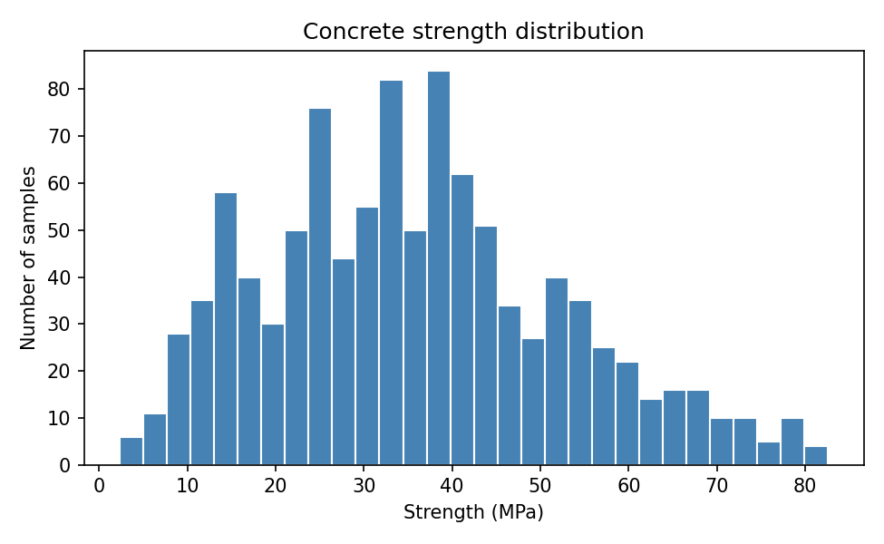

### Features vs strength

Most relationships are **nonlinear**. Blast Furnace Slag, Fly Ash and Superplasticizer contain many zeros because they are optional additives that are not used in every mix.

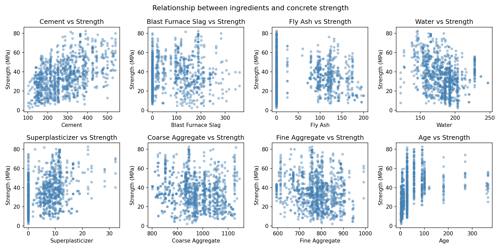

### Age

Strength grows quickly up to ~28 days (the standard curing period), then slows down and levels off. This curved pattern is the first sign that a linear model will struggle.

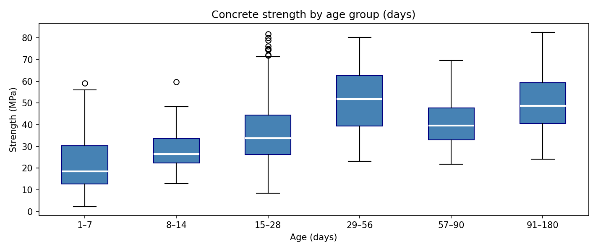

### Correlations

Cement (0.50), Superplasticizer (0.37) and Age (0.33) have the strongest positive correlation with strength. Water is negatively correlated (−0.29), consistent with Abrams' law: more water means lower strength.

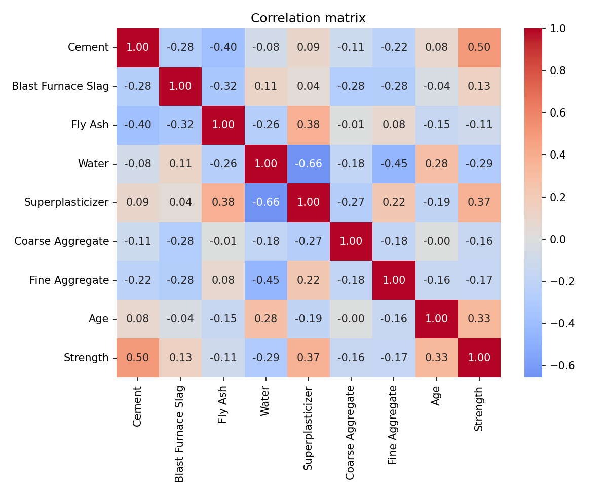

## Methodology

**Split:** 60% train (618) / 20% validation (206) / 20% test (206), `random_state=42`. The validation set is used for model decisions and the test set only for the final evaluation.

**Outlier capping (OLS only):** values outside `[Q1 − 1.5·IQR, Q3 + 1.5·IQR]` are clipped. The bounds are computed on the training set only and then applied to validation and test, which prevents data leakage. Capping improved OLS validation RMSE from 10.66 to 8.87 MPa. RF and XGBoost use uncapped data because tree models are not sensitive to outliers.

| Before capping | After capping |
|---|---|
| 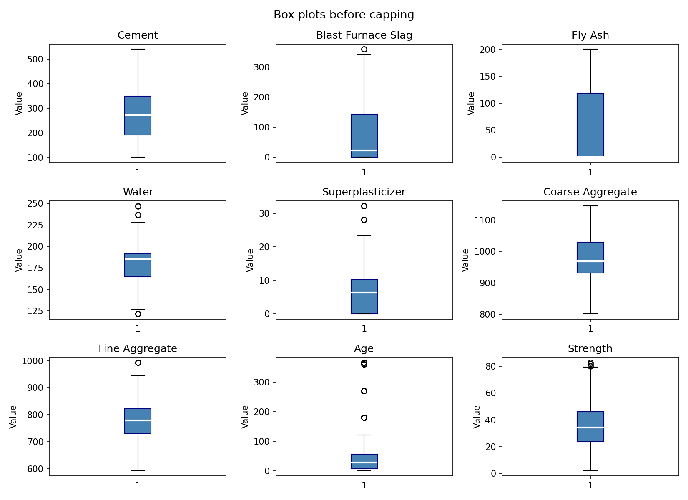 | 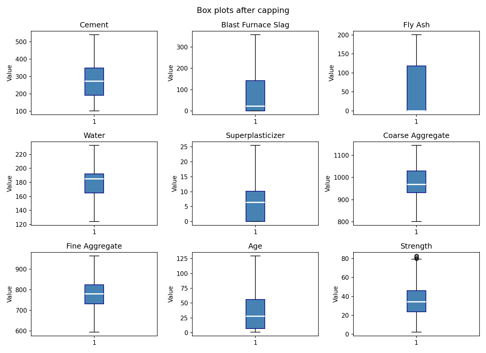 |

**OLS feature selection:** backward elimination on the validation set showed that dropping Superplasticizer, Fine Aggregate and Coarse Aggregate improves validation RMSE from 8.87 to 8.63 MPa. The final OLS model uses these 6 features: Cement, Blast Furnace Slag, Fly Ash, Water, Age and water_cement_ratio.

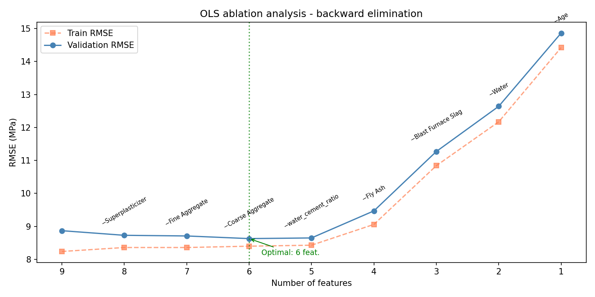

**Hyperparameter tuning:** RF and XGBoost are tuned with `GridSearchCV` (5-fold cross-validation, RMSE scoring).

| Model | Best parameters |
|---|---|
| Random Forest | `n_estimators=300`, `max_depth=15`, `min_samples_leaf=1`, `max_features=0.75` |
| XGBoost | `n_estimators=300`, `max_depth=3`, `learning_rate=0.1`, `subsample=0.8`, `colsample_bytree=0.7`, `reg_alpha=1.0`, `reg_lambda=1.0` |

**Metrics:** RMSE (penalizes large errors, which matters for safety), MAE (average absolute error) and MAPE (percentage error, independent of scale).

## Model results (test set)

| Model | RMSE | MAE | MAPE |
|-------|------|-----|------|
| OLS | 9.04 | 6.97 | 23.86% |
| Random Forest | 6.17 | 4.26 | 14.26% |
| **XGBoost** | **5.49** | **3.71** | **11.73%** |

XGBoost outperforms OLS by ~39% in RMSE. OLS was trained on the 6 optimal features (after ablation analysis), with outlier capping on the train set. XGBoost explains ~90% of the variance on the test set (R² = 0.897).

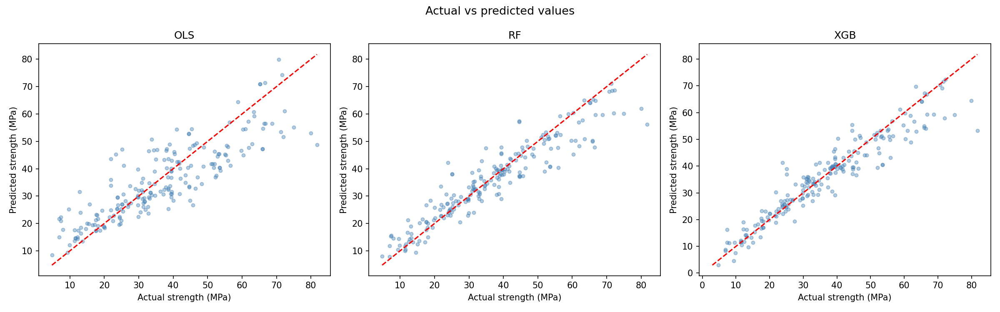

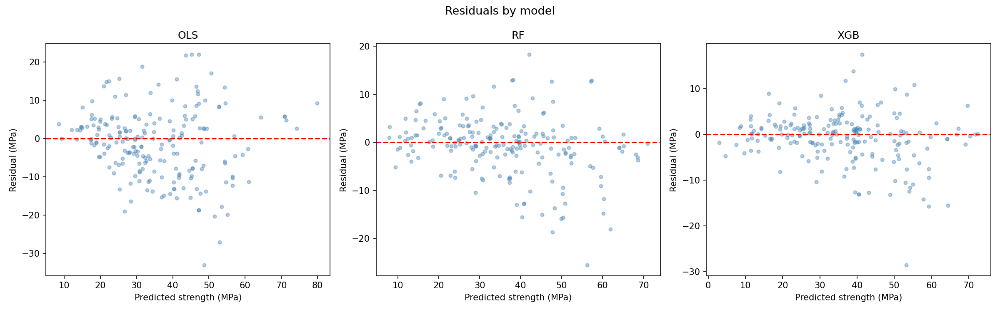

OLS shows a clear systematic pattern: it underestimates high strengths and overestimates low ones. The residuals of RF and XGBoost are spread evenly around zero.

### OLS assumption checks (LINE)

| Assumption | Test | Result | Status |
|---|---|---|---|
| Linearity | F-test | p = 5.6e-173 | Passed |
| Independence | Durbin-Watson | d = 1.90 | Passed |
| Normality | Anderson-Darling | p = 0.047 | Borderline fail |
| Equal variance | Goldfeld-Quandt | p = 0.50 | Passed |
| Collinearity | Max correlation | < 0.999 | Passed |

Normality is formally violated, but with n = 618 the central limit theorem still makes the coefficient estimates approximately normal. The bigger issue is that the F-test only shows that *some* linear relationship exists. The curved residual pattern shows that a linear form is not enough for this data.

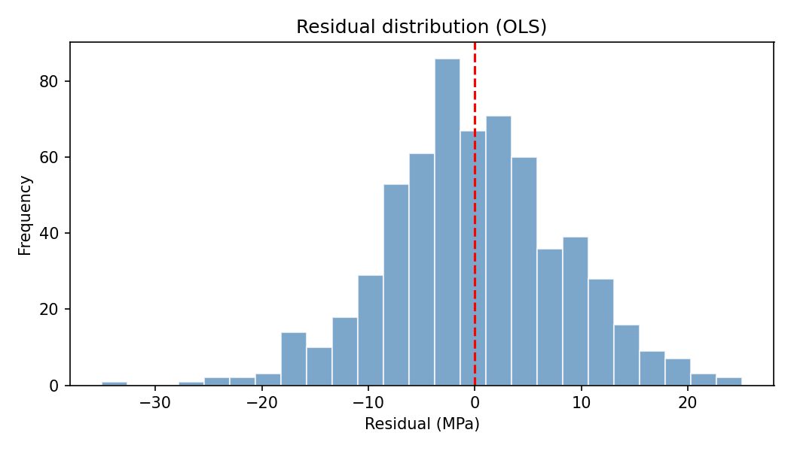

## Answers to the research questions

### Q1 — Which ingredients matter most?

According to XGBoost, **Age** and **water_cement_ratio** are by far the most important predictors, followed by **Cement**. Age reflects the cement hydration process, and water_cement_ratio directly encodes Abrams' law. Random Forest ranks the features almost the same way, which strengthens the conclusion.

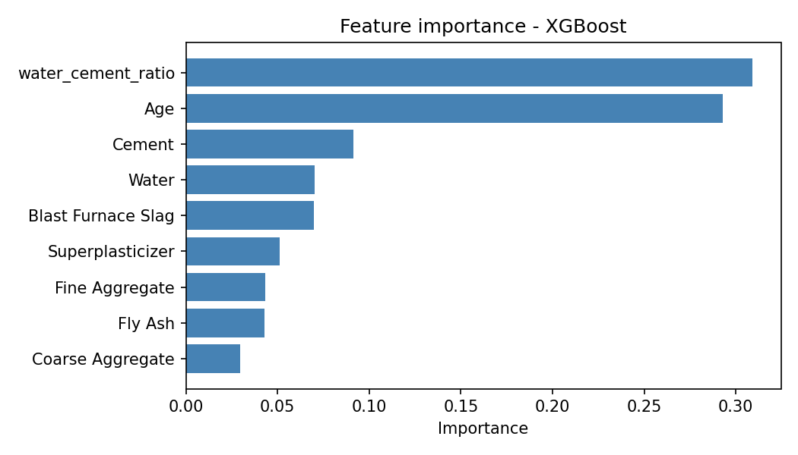

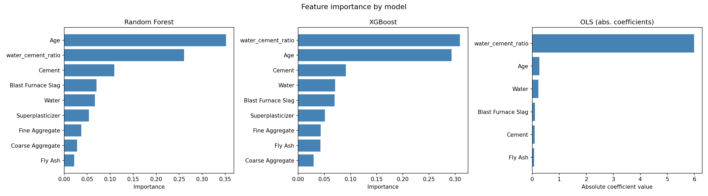

### Q2 — Is linear regression sufficient?

**No.** XGBoost beats OLS by ~39% in RMSE (5.49 vs 9.04 MPa) and Random Forest by ~11%. The relationships in the data are nonlinear, which is visible in the EDA (especially age) and confirmed by the OLS residual pattern, so OLS is structurally limited for this problem.

| OLS | Random Forest | XGBoost |
|---|---|---|
| 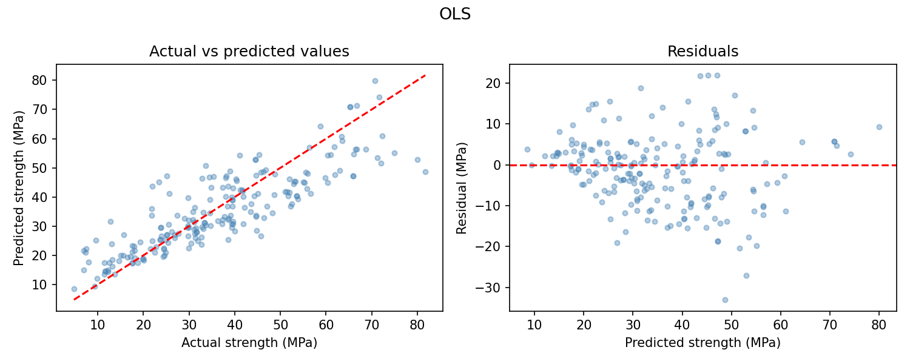 | 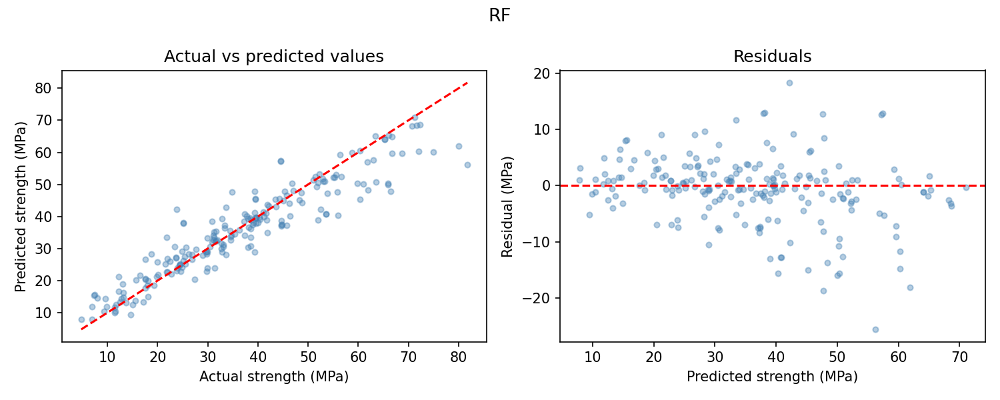 | 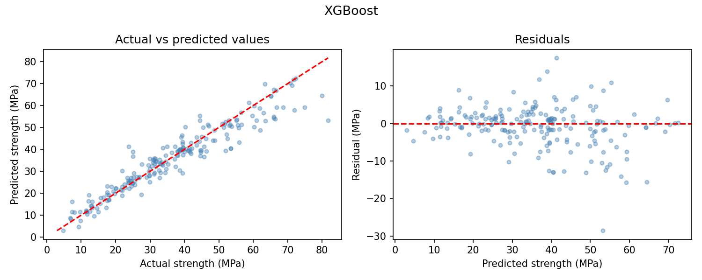 |

### Q3 — Which mix gives the highest predicted strength?

We generated 50,000 random mixes within the ranges of the training set and predicted their strength with XGBoost. The top 5:

| Cement | Slag | Fly Ash | Water | Superplast. | Coarse Agg. | Fine Agg. | Age (days) | W/C ratio | Predicted (MPa) |
|---|---|---|---|---|---|---|---|---|---|
| 407 | 319 | 49 | 154 | 10.5 | 965 | 630 | 279 | 0.38 | **93.0** |
| 377 | 309 | 61 | 143 | 7.8 | 831 | 633 | 221 | 0.38 | **92.4** |
| 468 | 318 | 3 | 181 | 10.7 | 1027 | 753 | 158 | 0.39 | **92.0** |
| 466 | 301 | 30 | 179 | 30.6 | 825 | 639 | 259 | 0.38 | **91.9** |
| 349 | 289 | 22 | 143 | 9.5 | 827 | 640 | 354 | 0.41 | **91.0** |

The model consistently prefers **high cement (350–470 kg/m³), high slag (~300 kg/m³), low water (water_cement_ratio ≈ 0.38) and an age of 200+ days**. These predictions exceed the highest strength in the training data (82.6 MPa), which means the model is extrapolating. They should be read as directions for mix design, not guaranteed values.

## Project structure

```
├── data/
│   └── concrete_data.csv      # dataset
├── src/
│   ├── preprocessing.py       # loading, feature engineering, data split
│   ├── models.py              # training OLS, RF, XGBoost (GridSearchCV)
│   ├── evaluation.py          # metrics (RMSE, MAE, MAPE) and pipeline entrypoint
│   ├── validation.py          # OLS model assumption checks
│   └── visualization.py       # plot generation
├── figures/                   # generated PNG plots
└── notebook.ipynb             # full analysis with narrative
```

## References

**Dataset**
- Tripathi, P. (2020). *Concrete Compressive Strength Dataset*. Kaggle.
  [https://www.kaggle.com/datasets/prathamtripathi/regression-with-neural-networking](https://www.kaggle.com/datasets/prathamtripathi/regression-with-neural-networking)

**Related work**
- Kadiwal, A. *EDA — Concrete Strength Prediction (R²=0.93)*. Kaggle Notebook.
  [https://www.kaggle.com/code/adityakadiwal/eda-concrete-strength-prediction-r2-0-93](https://www.kaggle.com/code/adityakadiwal/eda-concrete-strength-prediction-r2-0-93)

**Literature**
- Raschka, S., Liu, Y., & Mirjalili, V. (2022). *Machine Learning with PyTorch and Scikit-Learn*. Packt Publishing.
  [https://www.packtpub.com/product/machine-learning-with-pytorch-and-scikit-learn/9781801819312](https://www.packtpub.com/product/machine-learning-with-pytorch-and-scikit-learn/9781801819312)

**Abrams' law**
- Wikipedia: *Abrams' law — the relationship between the water-cement ratio and concrete strength*.
  [https://en.wikipedia.org/wiki/Abrams%27_law](https://en.wikipedia.org/wiki/Abrams%27_law)

## Running

```bash
pip install -r requirements.txt

# Full pipeline: train all three models + plots
python src/evaluation.py

# OLS assumption diagnostics
python src/validation.py

# Generate plots only
python src/visualization.py

# Interactive analysis
jupyter notebook notebook.ipynb
```
